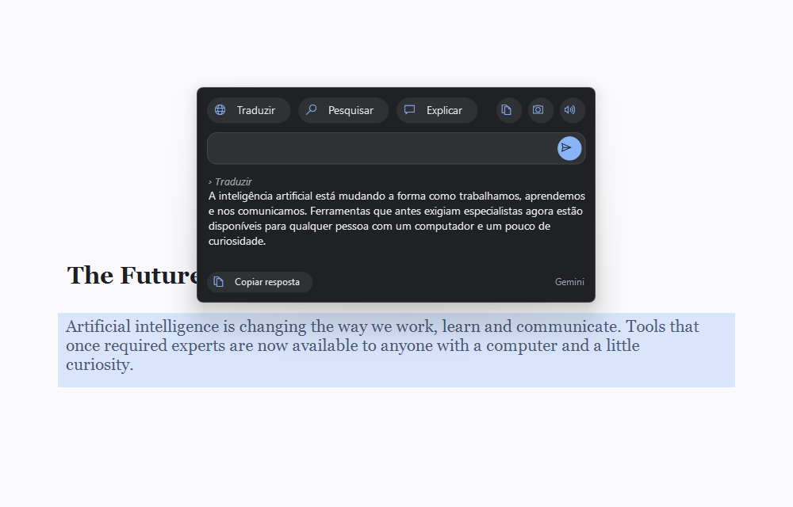
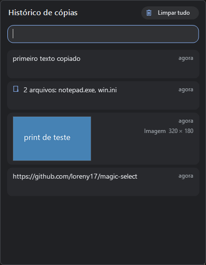
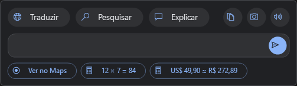
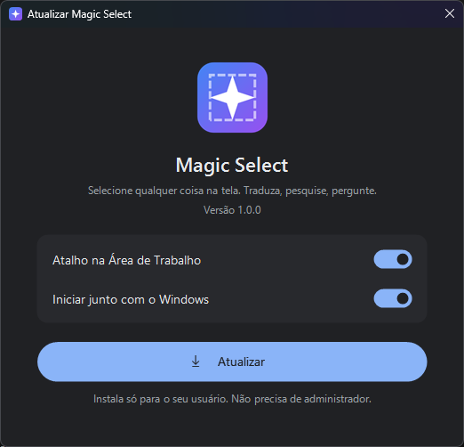
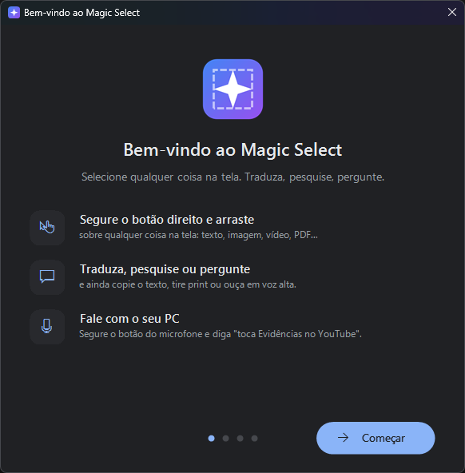
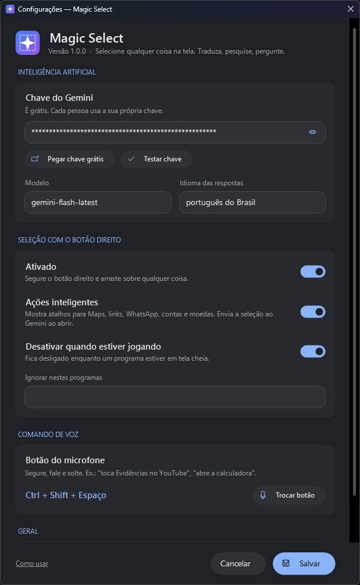

<p align="center">
  
</p>

<h1 align="center">Magic Select</h1>

<p align="center">
  <b>Selecione qualquer coisa na tela. Traduza, pesquise, pergunte.</b><br>
  Para Windows 10 e 11 · grátis
</p>

<p align="center">
  <a href="https://github.com/loreny17/magic-select/releases/latest/download/MagicSelect-Setup.exe"><b>⬇ Baixar para Windows</b></a>
  &nbsp;·&nbsp;
  <a href="https://loreny17.github.io/magic-select/">Site</a>
  &nbsp;·&nbsp;
  <a href="https://github.com/loreny17/magic-select/releases">Todas as versões</a>
</p>

<p align="center">
  
</p>

---

## O que ele faz

**Segure o botão direito do mouse e arraste** sobre qualquer coisa: texto, imagem, vídeo, PDF ou jogo.
Ao soltar, aparece um cartão em cima da seleção:

| | |
|---|---|
| 🌐 **Traduzir** | Traduz o que está na área selecionada |
| 🔍 **Pesquisar** | Cria a pesquisa e abre o Google |
| 💬 **Explicar / Perguntar** | Pergunte qualquer coisa sobre a seleção e continue a conversa |
| 📋 **Copiar texto** | Lê o texto de imagens e copia (OCR) |
| 📷 **Print** | Copia só a área selecionada e salva em `Imagens\Magic Select` |
| 🔊 **Ler em voz alta** | Lê o texto com a voz do Windows |
| 🕘 **Histórico de cópias** | Tudo que você copia no PC (textos, imagens, arquivos) fica guardado; clique para copiar de novo |

### Histórico de cópias

O Magic Select guarda o que você copia (Ctrl+C) em qualquer programa: **textos, links, imagens e arquivos**.
Abra pelo ícone 🕘 no cartão ou pelo menu do ícone perto do relógio, **busque** e **clique para copiar de novo**.
Senhas copiadas de gerenciadores de senha não são guardadas, e o histórico de textos fica salvo criptografado no seu PC.

<p align="center"></p>

Um clique normal com o botão direito continua abrindo o menu de sempre.

### Ações inteligentes

Quando faz sentido, aparecem atalhos sozinhos: **ver endereço no Maps**, **abrir link**, **mandar e-mail**,
**abrir conversa no WhatsApp**, **resultado de contas** e **preço em dólar/euro convertido para real** com a cotação do dia.

<p align="center"></p>

### 🎤 Comando de voz

Segure o botão do microfone (você escolhe qual: uma tecla ou um botão lateral do mouse), fale e solte:

- *"toca Evidências no YouTube"* → abre o vídeo já tocando
- *"abre a Steam"*, *"abre a calculadora"* → abre programas instalados
- *"abre o Gmail"* → abre o site
- *"pesquisa previsão do tempo"* → pesquisa no Google

### 🎮 Não atrapalha nos jogos

Enquanto um jogo estiver em tela cheia, o Magic Select se desliga sozinho.

## Instalar

1. **[Baixe o MagicSelect-Setup.exe](https://github.com/loreny17/magic-select/releases/latest/download/MagicSelect-Setup.exe)** e abra.
2. Se aparecer **"O Windows protegeu o computador"**, clique em **Mais informações › Executar assim mesmo**.
   Isso acontece com programas novos que ainda não têm assinatura digital.
3. Clique em **Instalar**. Não precisa ser administrador.
4. Um guia rápido ajuda você a conectar a IA (chave **grátis** do Google Gemini, leva 1 minuto) e a escolher o botão do microfone.

<p align="center">
  
  &nbsp;
  
</p>

Para desinstalar: **Configurações do Windows › Aplicativos › Magic Select › Desinstalar**.

## Configurações

<p align="center"></p>

## Perguntas frequentes

**É grátis?**
Sim. A IA usada é o Google Gemini, que tem um plano gratuito. Cada pessoa usa a própria chave, criada em
[aistudio.google.com/apikey](https://aistudio.google.com/apikey).

**Meus dados vão para algum lugar?**
A chave fica só no seu PC, criptografada pelo Windows. A área que você seleciona é enviada ao Google Gemini quando você
usa uma ação ou faz uma pergunta. Com as *ações inteligentes* ligadas, ela é enviada assim que o cartão abre (dá para desligar).
No comando de voz, o áudio gravado enquanto você segura o botão é enviado ao Gemini para ser entendido.
O Magic Select não tem servidor próprio e não coleta nada.

**O antivírus reclamou.**
O programa observa o mouse para detectar o arrasto com o botão direito, e alguns antivírus desconfiam disso em
programas novos. O código está todo aqui no repositório.

**Funciona em Mac ou Linux?**
Por enquanto, só Windows 10 e 11.

---

<details>
<summary><b>Para desenvolvedores</b></summary>

Não precisa instalar nada: usa o compilador C# que já vem no Windows (.NET Framework 4.x).

```powershell
powershell -ExecutionPolicy Bypass -File build.ps1 -Setup
```

Gera `bin\MagicSelect.exe` e o instalador `dist\MagicSelect-Setup.exe`. O ícone é gerado por `tools\make-icon.ps1`.
Para diagnosticar problemas: `MagicSelect.exe --debug` grava `%APPDATA%\MagicSelect\debug.log`.

</details>

## Licença

© 2026 loreny17. Você pode baixar e usar o Magic Select de graça. Copiar, modificar ou redistribuir o código ou o programa
precisa de autorização. Veja [LICENSE](LICENSE).
